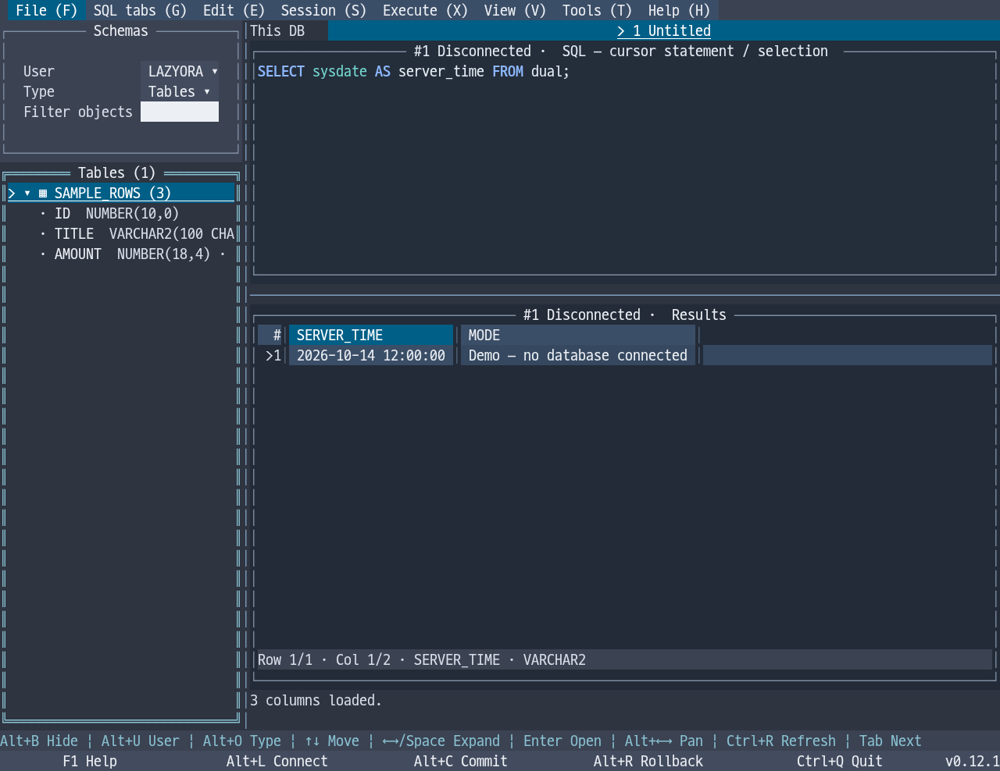

# LazyOra

[한국어 (default)](README.md) | **English**

**A Go-based Oracle terminal UI with Toad-like workflows.** Write and run SQL and PL/SQL, browse schemas, and explore and export results in a single executable.

LazyOra aims to make everyday Oracle development and inspection practical in a terminal, including over SSH, without installing Toad or purchasing its commercial license. It adapts familiar Toad workflows and shortcuts to a TUI. It is an independent project under active development, not a complete replacement for every Toad feature.

Current version: **0.10.2** · **Linux / Windows / macOS · AMD64 / ARM64**

- Oracle SQL/PL/SQL syntax highlighting, files and multiple SQL tabs, cursor-statement execution, F5 scripts and IN bind variables.
- Estimated execution plans, result copying, CSV/TSV/Excel/INSERT export, and manual commit/rollback.
- Schema objects, columns and comments, source and arguments, source editing and compilation.
- DBMS_OUTPUT, routine execution, object DDL/privileges/dependencies, additional result fetching, sorting/filtering, cell details and guarded editing.
- Toad (default), Vim, Notepad++, VS Code and IntelliJ IDEA editor keymaps; completion, formatting, dark/light/black-and-white themes, and Korean/English UI.



*v0.10.2 · Dark theme · English UI · DB-free demo widgets rendered in a simulated terminal.*

## Quick start

Download the executable for your system from [GitHub Releases](https://github.com/leechis7/lazyora/releases/latest). Running a release binary does not require Go or Oracle Instant Client.

| System | Executable |
| --- | --- |
| Linux x86_64 (including CentOS) | `lazyora-linux-amd64` |
| Linux ARM64 | `lazyora-linux-arm64` |
| Windows x86_64 | `lazyora-windows-amd64.exe` |
| Windows ARM64 | `lazyora-windows-arm64.exe` |
| macOS Intel | `lazyora-darwin-amd64` |
| macOS Apple Silicon | `lazyora-darwin-arm64` |

For example, on Linux ARM64:

```sh
chmod +x lazyora-linux-arm64
./lazyora-linux-arm64
```

Use the matching filename on other Linux architectures or macOS. On Windows, run the `.exe` in PowerShell, for example `.\lazyora-windows-amd64.exe`.

Use `--demo` to explore the UI without a database, or `--version` to print the version. The release includes `SHA256SUMS` for checking downloaded files.

The connection dialog opens at startup. Enter the host, port, username and password, choose **Service Name or SID**, and select Connect. Give the connection an alias to save its profile. Passwords are not saved by default; optional encrypted storage uses a master password. See [credential management](docs/en/credentials.md).

When no language is configured, a Korean locale selects Korean; other locales select English. Unix locale precedence is `LC_ALL`, `LC_MESSAGES`, then `LANG`. Change language, theme and mouse preferences in **Tools → Settings**. Saved language settings override locale detection.

## Common shortcuts

| Key | Action |
| --- | --- |
| F1 / F10 | Context help / main menu |
| Alt+L / Alt+J | Connection dialog / connection workspaces |
| F9 / Ctrl+Enter | Execute selected SQL, or the statement at the cursor |
| F5 / Ctrl+E | Execute script / estimated execution plan |
| Alt+W | Export results |
| Alt+C / Alt+R | Commit / rollback |
| Alt+B | Toggle schema browser |
| Alt+U / Alt+O | Select browser user / object type |
| F2 / Shift+F2 or F12 | Maximize/restore SQL editor / result grid |
| Ctrl+C / Alt+Y | Copy result cell or range / whole row |
| Ctrl+Q | Exit confirmation |

**F1** and the bottom shortcut bar describe the current panel and selected editor keymap. The **Help** menu contains the user guide, version history and environment diagnostics. If your terminal cannot distinguish Ctrl+Enter, use F9 or Alt+Enter; see [terminal troubleshooting](docs/en/terminal.md).

F9 executes a statement; F5 executes a script. F9 SELECT results are fetched from the same cursor in batches of 1,000 rows, with an in-memory limit of 10,000 rows or an estimated 64 MiB. Sorting and filtering operate on fetched rows. Exporting **all database results** re-executes the original SQL and streams results to a file without the grid's row limit. It can therefore observe different data from the original query.

DML requires an explicit commit. **Oracle DDL can commit implicitly.** Exit confirmation can show the potentially uncommitted work tracked by the application; it is not a complete audit of all server-side effects.

## Documentation

Start with the [documentation index](docs/en/index.md), which separates current guidance from historical evidence and design proposals.

- [Detailed usage](docs/en/usage.md) and the [offline user guide](docs/guide.en.md): connections, SQL tabs, scripts, transactions, schema browsing, grid editing and export. Also available inside the app.
- [Build and verification](docs/en/build.md): source builds, optional Oracle Free tests and compatibility limits.
- [Terminal troubleshooting](docs/en/terminal.md): Ctrl+Enter, function keys, 8-color mode, mouse and copying.
- [Credential management](docs/en/credentials.md): encrypted storage, master passwords and recovery options.
- [Contributing](docs/en/contributing.md) · [Support and security reports](docs/en/support.md) · [Code of conduct](CODE_OF_CONDUCT.en.md).
- [Release history](https://github.com/leechis7/lazyora/releases) and [detailed changelog (Korean)](CHANGELOG.md).

Korean remains the primary documentation language. Historical audits, detailed development records and older release notes are currently in Korean. The current English guides summarize practical use and preserve the documented verification limits.

## Implementation and shared UI

**Since v0.10.2, [Tuivory](https://github.com/leechis7/tuivory) v0.0.1** provides common themes, color profiles, input/choice/button/table/popup styles, grid states and syntax colors through `github.com/leechis7/tuivory/go`. Release users do not install a separate package.

tview/tcell handle terminal rendering and input; go-ora handles Oracle communication. LazyOra retains SQL parsing for display, database execution and transactions, Toad keymaps, grid data and application state. See [UI style rules](docs/en/ui-style.md) and [Tuivory integration](docs/en/tuivory-sync.md).

## Project and license

The initial screen layout was inspired by [lazySQL](https://github.com/jorgerojas26/lazysql). LazyOra now develops independently around Oracle and Toad-like terminal workflows. Common UI styling uses [Tuivory](https://github.com/leechis7/tuivory).

Developer: **이채강 (Chaekang Lee)** · leechis7@gmail.com

Copyright (C) 2026 Chaekang Lee. [GNU AGPL v3.0](LICENSE) (`AGPL-3.0-only`). Dependencies retain their own licenses.

## Next-version development

The unreleased branch adopts the **Tuivory v0.1.0** tree: expand tables/views for columns and types, and pan long names horizontally. See [tree controls](docs/en/usage.md). Published v0.10.2 downloads retain their existing behavior.

The unreleased branch adds saved **Auto/Unicode/ASCII** character display. Preview with `--demo --display-mode ascii`; see [terminal guidance](docs/en/terminal.md).
