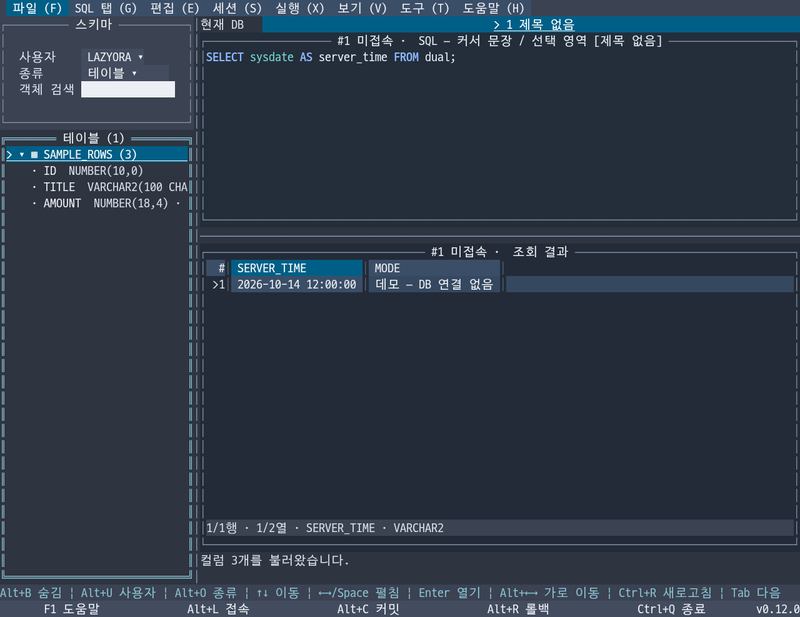

# LazyOra

[한국어 (기본)](README.md) | [English](README.en.md)

LazyOra is a Go-based terminal UI for Oracle, bringing Toad-like workflows to your terminal.
Write and execute SQL and PL/SQL, browse schema objects, and explore and export query results—all in a single executable.

**Toad처럼 Oracle을 다루는 터미널 도구**를 만듭니다.

Toad를 설치하고 상용 라이선스를 구매하는 부담 없이, 터미널에서도 Oracle 개발·조회·관리 작업을 충분히 할 수 있다는 생각에서 출발했습니다. 익숙한 Toad의 작업 흐름과 단축키를 TUI에 맞게 구현하는 것이 목표입니다.

SQL·PL/SQL 편집부터 스키마 탐색, 실행 결과 확인과 내보내기까지 하나의 화면에서 이어가고, SSH로 접속한 서버에서도 실행파일 하나로 사용할 수 있도록 개발합니다. Toad의 모든 기능을 갖춘 단계는 아니며, 실제 Oracle 작업에 필요한 기능을 차근차근 확장하고 있습니다.

현재 버전: **0.11.1** · **Linux / Windows / macOS · AMD64 / ARM64**

v0.11.1은 한글 등이 팝업 경계에 걸릴 때 접속·설정·앱 정보 창의 테두리가 깨지는 문제를 수정합니다. [릴리스 설명](docs/releases/v0.11.1.md)을 참고하세요.

- Oracle SQL·PL/SQL 구문 색상, SQL 파일·여러 편집 탭, 커서 문장·F5 스크립트 실행과 IN 바인드 입력
- 예상 실행 계획, 결과 조회·복사와 CSV·TSV·Excel·INSERT 내보내기, 수동 커밋·롤백
- 스키마 객체 탐색, 컬럼·코멘트·소스·인자 조회와 소스 편집·컴파일
- DBMS_OUTPUT·루틴 실행, 객체 DDL·권한·의존 관계 조회, 결과 추가 가져오기·정렬·필터와 셀 상세·안전 편집
- Toad·Vim 등 5종 편집기 키맵, 자동완성·SQL 정렬, 다크·라이트·흑백 테마와 한국어·영어 UI



*v0.11.0 · 다크 테마 · 한국어 UI · DB 연결 없는 데모 위젯의 모의 터미널 캡처.*

## 빠른 시작

[GitHub Releases](https://github.com/leechis7/lazyora/releases/latest)에서 환경에 맞는 실행파일을 받으세요. Go나 Oracle Instant Client를 따로 설치할 필요가 없습니다.

| 환경 | 실행파일 |
| --- | --- |
| Linux x86_64 (CentOS 포함) | `lazyora-linux-amd64` |
| Linux ARM64 | `lazyora-linux-arm64` |
| Windows x86_64 | `lazyora-windows-amd64.exe` |
| Windows ARM64 | `lazyora-windows-arm64.exe` |
| macOS Intel | `lazyora-darwin-amd64` |
| macOS Apple Silicon | `lazyora-darwin-arm64` |

Linux ARM64 실행 예시입니다. Linux의 다른 아키텍처나 macOS에서는 해당 파일명을 사용하세요.

```bash
chmod +x lazyora-linux-arm64
./lazyora-linux-arm64
```

Windows에서는 PowerShell에서 `.\lazyora-windows-amd64.exe`처럼 실행합니다. DB 없이 화면만 둘러보려면 `--demo`, 버전을 확인하려면 `--version`을 붙입니다.

언어를 저장하지 않았다면 `LC_ALL` → `LC_MESSAGES` → `LANG`의 첫 설정값이 한국어일 때 한국어, 그 외에는 영어로 시작합니다. 저장한 언어가 우선하며 **도구 → 설정**에서 바꿀 수 있습니다.

실행하면 접속 화면이 열립니다. Host·Port·계정·암호를 입력하고 **Service Name 또는 SID**를 선택한 뒤 접속 버튼을 누르세요. 별칭을 지정해 접속 정보를 저장할 수 있습니다. 비밀번호는 기본적으로 저장하지 않으며, **암호화 저장을 선택하면 마스터 비밀번호로 보호**합니다. [암호 관리 안내](docs/credentials.md)를 참고하세요.

## 자주 쓰는 키

| 키 | 동작 |
| --- | --- |
| F1 / F10 | 현재 화면의 도움말 / 상단 메뉴 |
| Alt+L / Alt+J | 접속 화면 / 접속 작업 공간 전환 |
| F9 / Ctrl+Enter | 선택한 SQL 실행 (선택이 없으면 커서 문장) |
| F5 / Ctrl+E | 스크립트 실행 / 예상 실행 계획 |
| Alt+W | 조회된 결과 내보내기 |
| Alt+C / Alt+R | 커밋 / 롤백 |
| Alt+B | 스키마 브라우저 표시·숨김 |
| Alt+U / Alt+O | 브라우저 사용자 / 객체 종류 선택 |
| F2 / Shift+F2·F12 | 쿼리 / 결과 전체화면·복원 |
| Ctrl+C / Alt+Y | 결과 셀·선택 범위 / 한 행 복사 |
| Ctrl+Q | 종료 확인 |

전체 조작은 **F1**과 화면 하단 안내에서 확인합니다. **도움말 메뉴**에서 내장 사용 가이드·버전 변경 이력·환경 진단도 열 수 있습니다. Ctrl+Enter가 구분되지 않는 터미널에서는 F9 또는 Alt+Enter를 사용하세요. 언어·마우스 설정은 **도구 → 설정**에서 변경합니다.

F9는 커서 문장을, F5는 스크립트를 실행합니다. F9 SELECT 결과는 같은 커서에서 1,000행씩 추가로 가져옵니다(화면 보관은 10,000행·추정 64 MiB). 가져온 행의 정렬·필터를 지원하며, 내보내기에서 **DB 전체 결과**를 선택하면 원 SQL을 재조회해 행 수 제한 없이 파일로 저장합니다. DML은 수동 커밋하고, **Oracle DDL은 암시적으로 커밋될 수 있습니다.** 종료할 때는 앱이 추적한 미커밋 가능 내역을 확인할 수 있습니다.

## 문서

[전체 문서 색인과 현행/보관 구분](docs/index.md)에서 필요한 안내를 찾을 수 있습니다.

- [UI 스타일·Tuivory 적용](docs/ui-style.md) — 공통 패키지와 테마/색상 프로필
- [사용 안내](docs/usage.md) — 접속 저장, 설정, 스키마 탐색, 전체 단축키와 트랜잭션
- [터미널 문제 해결](docs/terminal.md) — SecureCRT 키 매핑과 결과 복사
- [빌드와 검증](docs/build.md) — 소스 빌드, CentOS 호환성과 검증 범위
- [시험용 Oracle Free](test/oracle/README.md) — Docker Compose로 테스트 DB 실행
- [개발과 릴리스](docs/development.md) · [변경 이력](CHANGELOG.md) · [기여 안내](CONTRIBUTING.md)
- [사용 문의](SUPPORT.md) · [보안 제보](SECURITY.md) · [참여 규칙](CODE_OF_CONDUCT.md)

## 구현과 공통 UI

**v0.11.0은 [Tuivory](https://github.com/leechis7/tuivory) v0.1.0**을 가져와 테마·색상 프로필·입력·선택·버튼·표·팝업·그리드·SQL 문법색을 공통 패키지로 적용합니다. Go 모듈은 `github.com/leechis7/tuivory/go`이며, 실행파일 사용자에게 별도 설치는 필요하지 않습니다.

tview/tcell이 화면·입력을, go-ora가 Oracle 통신을 담당합니다. Oracle 실행·트랜잭션·SQL lexer·Toad 키맵·그리드 데이터와 화면별 상태는 LazyOra에서 관리합니다. [UI 스타일 규칙](docs/ui-style.md) · [Tuivory 적용·갱신 기록](docs/tuivory-sync.md)을 참고하세요.

## 참고 프로젝트

초기 화면 구성은 [lazySQL](https://github.com/jorgerojas26/lazysql)을 참고했습니다. 현재 LazyOra는 Oracle에 집중하며, Toad와 같은 작업 흐름을 터미널에서 제공하는 독립 프로젝트로 개발하고 있습니다.

## 개발자·라이선스

이채강 (Chaekang Lee) · leechis7@gmail.com

Copyright (C) 2026 Chaekang Lee. [GNU AGPL v3.0](LICENSE) (`AGPL-3.0-only`). 의존 라이브러리에는 각 프로젝트의 라이선스가 적용됩니다.

## v0.11.0 주요 개선

v0.11.0은 **Tuivory v0.1.0** 트리를 적용합니다. 테이블·뷰를 펼쳐 컬럼·자료형을 확인하고 긴 이름을 가로 탐색할 수 있습니다. [트리 사용법](docs/usage.md)을 참고하세요.

v0.11.0은 설정에서 **자동/Unicode/ASCII 문자 표시**를 선택할 수 있습니다. `--demo --display-mode ascii`로 호환 화면을 미리 볼 수 있습니다. [터미널 안내](docs/terminal.md)를 참고하세요.
