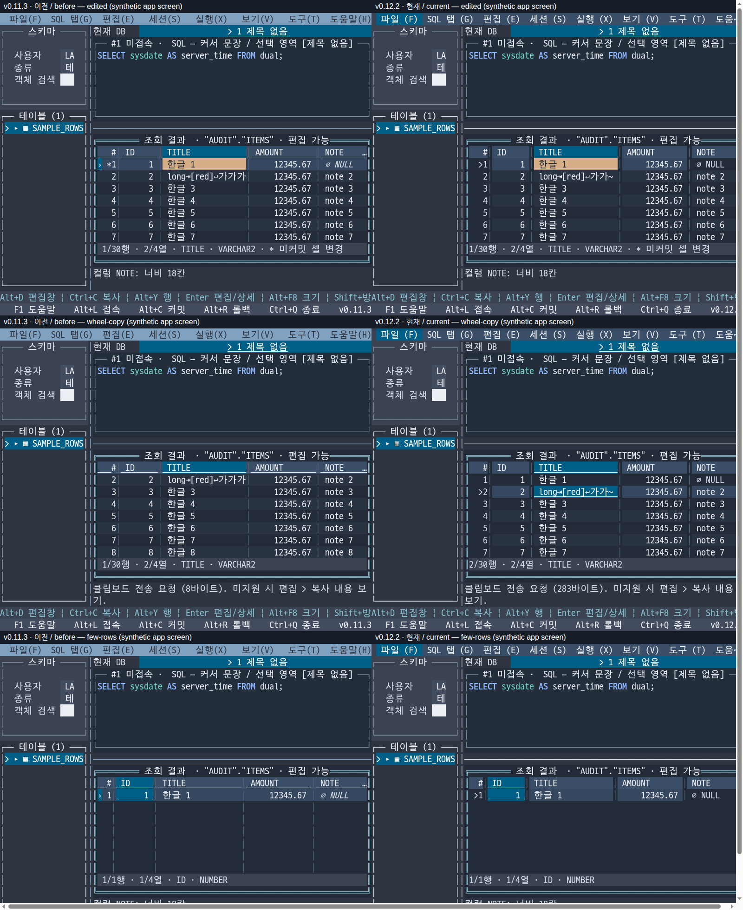

# LORA-76 그리드 전환 전후 기능 감사 / Grid regression audit

[한국어 적용 기록](../tuivory-sync.md) | [English integration record](../en/tuivory-sync.md)

후속 / Follow-up: 사용자 추가 요구로 일반 결과의 Enter·더블클릭 읽기 전용 팝업 대체 동작을 미배포 작업에서 수정 중입니다. 본문·JSON은 위 커밋의 v0.12.2 출하 상태 비교를 보존합니다. Subsequent unreleased work changes read-only Enter/double-click fallback following user clarification; this audit/JSON remains evidence for the released commits.

## 한국어

2026-11-03 사용자 요청에 따라 검사만 수행했습니다. **9가지 조작·표시 차이를 확인했습니다. 인라인/별도창 편집은 조건을 갖춘 합성 결과에서 현재도 동작했습니다.** 이번 결과만으로 사용자가 실DB에서 겪은 편집 불가 원인을 확정하지 않습니다. 제품 코드·SDK·설정·브랜치·버전은 변경하지 않았고 커밋·게시는 하지 않았습니다.

### 기준과 방법

- 이전: v0.11.3, `e87577b7ad044fcc37b866c98ddd8efa5e0ef199`. 공통 GridView 최초 도입 커밋 `b649ec705850b7e81f0d9f8353eac1d1487dc352`의 부모입니다. 이때 공통 스타일은 이미 Tuivory v0.2.0이지만 결과 본체는 LazyOra 자체 그리드였습니다. 전체 Tuivory 도입 시점과 그리드 컴포넌트 전환 시점을 구분합니다.
- 현재: v0.12.2, dev `89f455eac5be46bec45192616417bc935dcc80b0`. 릴리스 main `97ecec1503bf24625e35b174aa4f58bde23a9b39`와 파일 내용이 같습니다. 공개 SDK v0.10.2 사용.
- 이전 소스는 `/tmp`의 격리된 Git archive로 실행했습니다. 현재는 임시 `go test -overlay`로 진단을 주입해 저장소 Go 파일을 수정하지 않았습니다.
- 실제 앱 생성자·전역 입력 capture·포커스 위젯/루트 마우스 handler·BeforeDraw/ForceDraw·Show를 사용했습니다. 동일한 80×24 화면에서 30행, 4개 표시 열, 숨긴 ROWID와 편집 메타데이터를 넣었습니다. SQL 작업 전송은 차단했습니다.
- 버전별 35개 조작/상태 시나리오와 12팔레트(3테마 × 8/16/256/truecolor) 시나리오, 총 **47개씩 94개 관찰 기록**. 양쪽 모두 패닉이 없고 원문 SQL은 보존됐습니다. 관찰 수는 기능 통과 수가 아니며 전후 값을 비교해 차이를 판정했습니다.
- 기존 그리드 관련 검사 **24개는 양쪽 모두 통과**했습니다. 초기 20개와 추가 4개를 합산했으며 임시 진단 자체를 기존 검사 수에 포함하지 않았습니다. 실제 UI 동작과 표시 속성의 비교를 대신하지 않습니다.

원본 관찰: [이전 JSON](evidence/lora-76-grid-before.json) · [현재 JSON](evidence/lora-76-grid-after.json) · [현재용 진단 원문](evidence/lora-76-grid-probe.go.txt).

### 확인한 차이와 담당

| 항목 | 전환 직전 | 현재 | 원인·주요 담당 |
| --- | --- | --- | --- |
| 휠과 복사 대상 | 휠 아래 1회: 선택 `[1,1]` 유지, offset `[1,0]`. Ctrl+C는 1행 값 | 선택 `[2,1]`, offset `[0,0]`. Ctrl+C는 2행 값 | 보기 스크롤이 선택 이동으로 변경. SDK Grid.Pointer의 휠 동작과 앱 연결 계약 |
| 읽기 전용 문자 탐색 | `j/k/h/l` 이동, `g/G` 처음/끝 | 6개 모두 무반응 | 앱 resultGridKey가 KeyRune을 전달하지 않으며 SDK GridKey/NavigationKey에도 같은 별칭이 없음. LazyOra 키 연결 + 공통 탐색 계약 |
| Home/End 및 Ctrl 조합 | Home/Ctrl+Home은 `[1,0]`, End/Ctrl+End는 `[30,3]` | `[1,2]` 또는 `[30,1]`로 기존 열 유지 | SDK first/last는 행만 이동. 앱이 이전 셀 단위 의미를 보존하지 않음. LazyOra 키 매핑 |
| Alt+오른쪽 | 선택 `[1,1]→[1,2]` | `[1,1]` 유지, 화면 변화 없음 | SDK cell_pan_right로 전달되지만 앱의 열 overflow는 ellipsis. 예전 modifier 허용 동작과의 호환 차이이며 문서화된 주요 키였다고 단정하지 않음. LazyOra 연결 |
| 헤더 클릭 | 첫 열 헤더 클릭으로 활성 열 `[1,0]` | 기존 `[1,1]` 유지 | DisableHeaderSort=true이면 SDK가 헤더 클릭 자체를 무시. 정렬 허용과 열 선택을 분리할 SDK/앱 연결 필요 |
| 헤더/NULL 글자 속성 | 비활성 열 헤더 밑줄, NULL 기울임 | 두 속성 모두 사라짐, 12팔레트 전체 | 앱 stylePair와 SDK Pair가 FG/BG/Bold만 전달. SDK GridView 스타일 계약과 소비 어댑터 |
| NULL 현재 행 배경 | 현재 행의 NULL도 같은 현재 행 배경 유지 | NULL만 기본 셀 배경으로 끊김. 다크/라이트의 256/truecolor 4조합 | SDK cellRole의 grid.null이 현재 행 배경 조합을 덮음. 공통 상태 합성 |
| 수정된 행 번호 `*` | 수정 셀 배경 + 행 번호 `*` + 상태줄 `*` | 셀 배경과 상태줄은 유지, 행 번호 `*` 없음 | 전환 당시 알려진 생략. SDK row Edited를 주면 행 전체가 편집색으로 바뀌어 셀별 편집색과 행 변경 표식을 분리하지 못함. SDK 보완 후 앱 연결 |
| 빈 영역 열 구분선 | 결과가 1행이어도 아래 빈 영역에 `│` 유지 | 데이터 행 아래 빈 영역은 공백 | SDK GridView의 빈 행 채우기/구분선 옵션 보완 |

휠은 복사·편집의 선택 대상과 연결되므로 우선 호환성을 복원할 항목입니다. Home/End와 읽기 전용 문자 탐색도 기존 습관에 직접 영향을 줍니다. 헤더 클릭 정렬은 양쪽 모두 없었으므로 새로 사라진 기능에 포함하지 않았습니다. 대신 기존의 헤더를 눌러 열을 선택하는 동작이 없어졌습니다.

행 번호 `*` 생략은 [당시 적용 기록](lora-76-menu-grid.md)에 명시돼 있습니다. 따라서 우발적인 코드 삭제로 판정하지 않고, 이전 표현이 아직 복원되지 않은 알려진 제약으로 분류합니다. 사용자 검토 없이 영구적으로 제외할 근거로 삼지 않습니다. SDK의 행 상태와 셀 상태를 분리하면 일반 데이터 그리드에서도 사용할 수 있는 기능입니다.

행 번호 클릭은 행 범위 복사를 유지하지만 활성 열은 이전의 첫 열 대신 기존 열을 유지합니다. 이 역시 선택 포커스 정책의 추가 호환 차이입니다. 현재 행 기호 `›`가 `>`로 바뀐 것은 기록된 표시 변경이며 독립적인 기능 삭제로 세지 않았습니다.

헤더의 기본 전경/배경색 자체는 12팔레트 모두 이전과 같았습니다. 현재 열의 강조색·밑줄도 남아 있습니다. 실제로 빠진 것은 비활성 열 헤더의 밑줄과 NULL의 속성/상태 합성 등이며, 헤더 전체가 없어졌다고 표현하지 않습니다.

### 보존되거나 추가된 기능

| 기능 | 확인 결과 |
| --- | --- |
| 셀 내 편집 | 편집 가능한 메타데이터가 있을 때 Enter·문자 입력·더블클릭으로 grid_inline 화면과 입력값 확인 |
| 별도 편집창 | Alt+D로 grid_edit 화면과 폼 확인, 동일 하단 안내 유지 |
| 편집 조건·안전 | ROWID 숨김, 원본 컬럼/행 매핑, 읽기 전용 Enter 상세 보기, 미리보기/취소·정렬/필터 후 대상·트랜잭션 후 재조회 관련 기존 검사 통과 |
| 편집 셀 표시 | 선택/비선택 편집 셀 배경과 `* 미커밋 셀 변경` 상태줄 보존 |
| 복사·선택 | Ctrl+C 셀, Alt+Y 행, Shift+방향키 범위, 마우스 범위, 행 번호로 행 선택 유지. 긴 값·탭·개행·`[red]` 원문 보존 |
| 보기 조작 | 방향키·PgUp/PgDn·필터·메뉴 정렬·열 폭 증감/자동 폭과 탭별 폭 유지 확인 |
| 헤더 경계 드래그 | 이전에는 폭 변화 0, 현재 +4. 전환 후 추가된 기능 |
| 기타 표시 | 숫자 우측 정렬·행 번호·현재 셀/행·줄무늬·상태줄·NULL 문자 표시 관련 기존 검사 통과 |

그리드의 `DisableEditing=true`는 SDK의 일반 데모 편집 요청을 끄는 설정입니다. LazyOra는 이를 별도 Oracle 편집 흐름으로 처리하며, Enter/더블클릭/Alt+D는 앱 명령에 연결돼 있습니다. 이 플래그만 보고 Oracle 편집이 제거됐다고 판정하면 안 됩니다. SDK는 일반 편집 요청/메타데이터를 제공하지만 입력창부터 Oracle UPDATE까지 자동 구현하는 구성은 아닙니다.

사용자 환경에서 편집이 안 되는 현상은 별도 확인이 남습니다. 접속·작업 중 여부, 트랜잭션 불확실 상태, 실제 결과의 EditID/원본 컬럼/ROWID 확인 여부에 따라 편집 허용이 달라집니다. 이번 합성 메타데이터 검사는 실DB에서 이 조건이 부여됐음을 증명하지 않습니다. 비교 범위에서 `internal/oracle/`는 변경되지 않았습니다.

### Tuivory와 LazyOra의 경계

- Tuivory: 셀 입력 위젯·배치·헤더/상태/표식·속성 전달·선택·스크롤 등 재사용 UI. 특히 FG/BG/Bold만 있는 Pair에 속성 전달, NULL+현재 행 합성, 행 변경 표식과 셀 편집색 분리, 헤더 선택과 정렬 분리가 필요합니다. Go만의 임시 우회 대신 언어 중립 컴포넌트 계약으로 보완할 범위입니다.
- LazyOra: Oracle ROWID·원본 컬럼 확인, 편집 허용·형변환·UPDATE·확인·commit/rollback, 공통 UI에 상태를 전달하는 어댑터와 Toad 키 매핑. 공통 API가 있어도 이 연결을 생략하면 기존 기능이 복원되지 않습니다.
- 기존 호환 Table에는 정확한 셀 스타일/선택 메타데이터가 남아도 실제 본문은 GridView가 그립니다. Table 속성만 확인하는 검사는 새 렌더링의 밑줄·기울임이나 휠 동작 차이를 잡지 못했습니다. 복원 시 실제 앱 입력·Show 결과를 수용 기준으로 삼아야 합니다.

이미지는 한국어·Unicode·기본 Toad 키맵을 사용하는 실제 앱의 시뮬레이션 화면입니다. 영어/ASCII/다른 키맵 조합을 이번에 재시험한 것은 아닙니다. 실DB·원격 터미널·물리 폰트·Windows/macOS의 실제 콘솔을 이번 검사에서 검증한 것은 아닙니다. 수정을 구현하거나 전체 기능이 정상이라고 선언하지 않습니다.

### 진단 재현

현재용 fixture는 `.go.txt`로 보관하므로 일반 Go 빌드/테스트에 자동 포함되지 않습니다. 이를 `internal/ui/grid_migration_probe_test.go`의 가상 파일로 매핑하는 Go overlay를 만들어 `go test -overlay <overlay.json> ./internal/ui -run '^TestGridMigrationProbe$' -count=1 -v`로 실행했습니다. `GRID_AUDIT_DIR`로 JSON/TXT 화면 저장 경로를 지정합니다.

이전 archive에서는 root Tuivory alias를 원래 tview/tcell import로 치환하고, 없는 resultCellRect helper를 기존 Table.GetCell(...).GetLastPosition()에 그대로 연결했습니다. 조작/데이터/기대 출력은 바꾸지 않았습니다. 진단 도구의 초기 namespace·가려진 열·명령 호출 오류를 바로잡고 최종 데이터를 재실행했으며, 도구 자체의 오류를 제품 결함으로 세지 않았습니다.

## English

This 2026-11-03 investigation performed **no product fix, commit or publication**. It found **nine behavior/presentation differences**. Inline and separate-dialog editing still worked under the synthetic editable-result conditions; the user's actual live-DB editing failure is not diagnosed by that result alone.

### Baseline and evidence

Compare v0.11.3 `e87577b7ad044fcc37b866c98ddd8efa5e0ef199` (parent of first shared GridView commit `b649ec705850b7e81f0d9f8353eac1d1487dc352`) with current v0.12.2/dev `89f455eac5be46bec45192616417bc935dcc80b0`, identical in file contents to released main `97ecec1503bf24625e35b174aa4f58bde23a9b39`. The baseline already used Tuivory v0.2.0 styles but owned the result renderer; current uses the shared component in v0.10.2.

An isolated Git archive and temporary Go overlay ran the real app constructor, global/focused/root input handlers and ForceDraw/Show, at the same actual 80×24 viewport with identical synthetic 30-row data, four visible columns and hidden ROWID. SQL submission was disabled. There are **47 observations per version, 94 total**: 35 action/state scenarios plus 12 theme/color combinations. No panics or SQL text changes. Observations are not a blanket pass count. All **24 existing grid tests** also passed in both versions; they did not cover the differences below. See the linked before/after JSON and diagnostic fixture above.

### Findings and ownership

| Difference | Before → current | Primary owner |
| --- | --- | --- |
| Wheel changes selection/copy target | Wheel retained `[1,1]` with offset `[1,0]`; now selects `[2,1]` with offset `[0,0]`. Subsequent copy changes rows | SDK pointer/scroll semantics plus app integration |
| Read-only `j/k/h/l`, `g/G` | Navigation → no action for all six keys | App key filter; SDK navigation has no equivalent aliases |
| Home/End and Ctrl combinations | Top-left/bottom-right `[1,0]`/`[30,3]` → first/last row retaining the column | App maps previous cell semantics to SDK row-only first/last |
| Alt+Right | Next column → no visible action, because cell pan is paired with ellipsis overflow | App binding/overflow compatibility; prior acceptance was not necessarily a documented primary shortcut |
| Header-click column selection | Selects first column → retains previous column | SDK DisableHeaderSort also suppresses header focus; separate selection from sorting |
| Header/NULL attributes | Inactive-header underline and NULL italic → lost in all 12 palettes | App stylePair/SDK Pair only carry FG/BG/Bold; shared style contract and adapter |
| NULL current-row background | Row highlight continues through NULL → NULL uses base background in dark/light 256/truecolor | SDK cell-role state composition |
| Edited row-number `*` | Cell background + row `*` + status `*` → cell/status retained, row `*` omitted | Known migration tradeoff: SDK row Edited also colors all cells; separate row indicator from cell editing |
| Empty-area column lines | One-row results retain vertical lines below data → blank spaces | SDK empty-row decoration/fill option |

The first wheel finding changes the target for later copy/edit operations and deserves priority. Header-click sorting did not exist in either baseline and is not claimed lost. Header foreground/background colors are unchanged across all 12 palettes, and the active header retains highlighting/underline. The lost inactive-header underline is a precise attribute regression, not wholesale removal of header styling. The row-marker omission was documented in the earlier integration report; treat it as an unresolved fidelity gap rather than accidental deletion or permanent user-approved removal.

### Retained capabilities and limits

Editable-result Enter/typing/double-click inline editing, Alt+D dialog and footer, hidden ROWID/source mapping/safe confirmation and transaction-refresh tests, edited-cell backgrounds/status, raw cell/row/range copying, long/multiline/tag-looking values, arrow/page navigation, filtering/menu sorting/width sizing and persisted tab widths remain. Header-divider dragging is an addition (width delta 0 before, +4 now). Existing tests also cover numeric alignment, numbers/stripes/selection/status and NULL text.

DisableEditing=true suppresses generic SDK edit requests while LazyOra explicitly routes Oracle inline/dialog editing. It is not evidence that host editing was removed. Live edit eligibility still depends on connection/busy/transaction state and genuine EditID/original-column/ROWID metadata; synthetic metadata cannot establish these on the user's server. `internal/oracle/` is unchanged across the compared range.

Tuivory should own reusable cell-input/rendering/layout, header/state/attribute/selection/scroll behavior and language-neutral contracts. LazyOra owns Oracle identification/eligibility/conversion/UPDATE/approval/transactions and the data/state/Toad-key adapter. Current compatibility Table metadata is not the rendered GridView body, so metadata-only tests missed these regressions. Restore acceptance criteria at the actual input/Show layer. Row-number clicks still copy the whole row but retain the previous active column instead of moving to the first; this is another focus-policy compatibility difference. The `›` to `>` current-row glyph is a documented cosmetic change, not counted as an independent feature deletion. The comparison uses Korean/Unicode/default Toad keys; English/ASCII/other-keymap combinations were not rerun. The image is simulated app output with synthetic data, not physical-terminal/live-DB/other-OS console certification.

The `.go.txt` fixture is opt-in via a virtual test-file overlay and does not enter ordinary builds. The baseline adapter only restores native imports and GetLastPosition-based coordinates; the dataset/actions stay the same. Initial probe namespace/hidden-column/command-call mistakes were corrected and final observations rerun, not counted as product defects.
