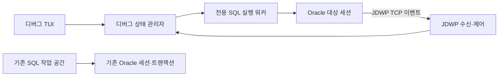

# PL/SQL 디버거 지원 타당성 검토

[한국어](plsql-debugger.md) | [English summary](en/plsql-debugger.md)

> 설계 보관 자료입니다. 현재 v0.10.2에도 중단점·스텝 디버거는 구현되지 않았습니다. / Design record only; v0.10.2 has no breakpoint/step debugger.

검토일: 2026-10-22 · Jira: LORA-53 · 상태: 조사·설계 제안.
이 문서는 구현 여부를 결정하기 위한 자료입니다. 현재 LazyOra에는 중단점·스텝 실행 디버거가 없습니다.

## 판단

**TUI와 단일 Go 실행파일이라는 조건으로도 구현할 가능성은 있습니다.** 다만 기존 프로시저 실행에
버튼 몇 개를 추가하는 규모는 아닙니다. 디버그 전용 실행·제어 채널과 상태 관리가 필요합니다.
아래 API 비교를 근거로 한 설계 판단이며, go-ora와 Oracle의 디버그 연동 실증을 마쳤다는 뜻은 아닙니다.

권장 순서는 현대 Oracle의 **JDWP 최소 실증 → 계속 진행 여부 결정 → TUI MVP**입니다.
10g 지원은 실제 10g 서버를 확보한 뒤 별도 실증으로 판단합니다.
이 일감에서는 조사만 마치며, 디버거 구현·권한 부여·서버 설정 변경은 별도 결정 사항으로 남깁니다.

## API 비교

| 항목 | DBMS_DEBUG | DBMS_DEBUG_JDWP |
| --- | --- | --- |
| 제어 방식 | 실행 대상과 감독용 두 DB 세션 | DB 세션이 클라이언트의 JDWP 수신 포트로 연결 |
| 구형 버전 근거 | Oracle 10.2 공식 API 문서 존재 | 10.2 문서에도 JDWP와의 동시 사용 제한이 있으나 실제 10g 조합은 미검증 |
| 현재 방향 | 12.2부터 deprecated | Oracle이 권장하는 대체 API |
| Go 구현 부담 | PL/SQL API 호출·레코드/출력 변환·양방향 세션 조정 | JDWP 전송·비동기 이벤트·Oracle 확장·PL/SQL 소스/타입 대응 |
| 네트워크 | 기본적으로 두 SQL 접속을 통한 제어 설계 | SQL 접속 외 DB → 디버거 TCP 경로·권한 필요 |
| 제안 | 구형 서버·역방향 경로 제약의 후속 후보 | 현대 Oracle 최소 실증의 첫 후보 |

`DBMS_DEBUG`의 대상/감독 세션 구조, 디버그 심벌과 중단점·변수 API는
[Oracle 10.2 DBMS_DEBUG 문서](https://docs.oracle.com/cd/B19306_01/appdev.102/b14258/d_debug.htm)에 근거합니다.
`deprecated`는 삭제와 다릅니다. 현재 버전에서 패키지가 제거됐다고 단정하지 않습니다.
[Oracle의 12.2 폐기 예정 안내](https://docs.oracle.com/en/database/oracle/oracle-database/12.2/upgrd/deprecated-features-oracle-database-12c-r2.html)를 기준으로 신규 주력 구현 선택을 평가했습니다.

## 권한·컴파일·접속 조건

- 자신의 세션을 연결하는 `DEBUG CONNECT SESSION`과 대상 객체 디버그 권한을 구분합니다.
  타 사용자 세션 연결은 버전에 맞는 추가 권한이 필요합니다. 폭넓은 `DEBUG CONNECT ANY`를 기본 요구하지 않고
  처음에는 자기 계정·자기 객체만 지원하는 범위를 제안합니다.
  [19c DBMS_DEBUG_JDWP 권한 모델](https://docs.oracle.com/en/database/oracle/oracle-database/19/arpls/DBMS_DEBUG_JDWP.html)
- 타 사용자 객체는 개별 `DEBUG` 권한과 실행 권한을 검토합니다. `DEBUG ANY PROCEDURE`는 기본 설치 요건으로 삼지 않습니다.
  `COMPILE DEBUG`가 필요한 기존 객체는 자동 재컴파일하지 않습니다. 컴파일은 DDL이며 현재 작업과 분리한 명시적 확인이 필요합니다.
  세션의 `PLSQL_DEBUG` 설정만으로 기존 객체가 재컴파일되지는 않습니다.
  [10.2 디버그 초기화·컴파일 안내](https://docs.oracle.com/cd/B19306_01/appdev.102/b14258/d_debug.htm)
- 19c JDWP에는 대상 호스트·포트에 대한 `jdwp` ACL 권한과 DB에서 LazyOra 호스트로 오는 경로가 필요합니다.
  DB에 SQL 접속이 된다고 역방향 TCP 접속까지 되는 것은 아닙니다. SSH·VPN·NAT·컨테이너 환경에서는
  DB가 도달할 주소와 수신 주소를 따로 확인해야 합니다. 19c ACL 설정 SQL을 10g에 그대로 적용하지 않습니다.
  [JDWP 네트워크 ACL 안내](https://docs.oracle.com/en/database/oracle/oracle-database/19/dbseg/configuring-network-access-java-debug-wire-protocol-operations.html)

go-ora는 SQL/PLSQL 제어 접속을 담당하고, JDWP 전송은 Go의 TCP 기능으로 구현하는 구조를 제안합니다.
이를 통해 클라이언트에 JRE·Instant Client·CGO를 추가하지 않는 목표를 유지할 수 있을 것으로 판단합니다.
이것은 구현 가설입니다. Oracle의 PL/SQL 런타임 값·객체·소스 표현과 확장 명령을 실제로 검증해야 합니다.

## 최소 실증에서 풀어야 할 문제

1. **전송:** `CONNECT_TCP`가 로컬 시험 DB에서 명시한 수신 포트로 연결되는지 확인합니다.
   JDWP는 패킷·응답 ID와 비동기 이벤트를 처리해야 하므로 일반 SQL 요청/응답 처리에 섞지 않습니다.
   [JDWP 전송 명세](https://docs.oracle.com/en/java/javase/21/docs/specs/jdwp/jdwp-spec.html)
2. **Oracle 확장:** 표준 Java JDWP 구현이 PL/SQL에 그대로 통한다고 가정하지 않습니다.
   `CONNECT_TCP`의 `extensions_cmd_set` 기본값은 128이며 Oracle 확장을 명시합니다.
   확장 규약·라이선스가 명확한 공개 문서나 구현을 확보하지 못하면 여기서 보류합니다.
   [CONNECT_TCP API](https://docs.oracle.com/en/database/oracle/oracle-database/19/arpls/DBMS_DEBUG_JDWP.html)
3. **소스 매핑:** 패키지 명세/본문, 프로시저, 함수의 실제 실행 행을 편집기 행으로 대응합니다.
   소스가 수정되거나 다시 컴파일되면 기존 중단점·변수 참조를 무효화합니다.
4. **자료형:** 첫 실증은 NUMBER·VARCHAR2·DATE·NULL의 읽기 전용 변수 보기로 제한합니다.
   컬렉션·레코드·LOB·패키지 전역·변수 수정은 지원 가능 여부를 별도 판정합니다.
5. **정리:** 정상 완료·오류·취소·단절·앱 종료 각각에서 실행 대상과 제어 연결이 남지 않아야 합니다.
   디버거 분리는 실행 재개나 대상 세션 종료를 일으킬 수 있으므로 ‘중지’와 같은 동작으로 취급하지 않습니다.
   [DISCONNECT 동작](https://docs.oracle.com/en/database/oracle/oracle-database/19/arpls/DBMS_DEBUG_JDWP.html)

## LazyOra에 맞는 구조 제안

디버그 대상은 **새 전용 작업 공간**으로 열어 기존 사용자의 미커밋 트랜잭션과 분리합니다.
소스·실행 인자를 가져오더라도 기존 세션의 패키지 변수·임시 테이블·ALTER SESSION 상태를 자동 복제하지는 않습니다.
독립 세션이라는 점을 실행 전에 표시해야 합니다.

현재 접속별 SQL 워커는 하나의 긴 작업을 처리하는 동안 다른 SQL을 실행하지 않습니다.
따라서 디버그 제어를 같은 작업 큐에 넣으면 실행이 중단점에서 멈춘 동안 제어도 대기하는 교착을 만들 수 있습니다.
수신·제어와 실행 워커를 분리하고 화면 변경만 기존 tview 이벤트 루프로 전달해야 합니다.

제안 상태: 준비 → 연결 중 → 실행 중 ↔ 중단됨 → 완료/오류/연결 끊김.
연결 중과 실행 중에는 변수 갱신·중단점 상태를 명확히 표시하며, 중단 상태만 변수 조회와 스텝을 허용합니다.
현재 기본 SQL 60초 제한을 디버그 전체 수명에 적용하지 않고 각 제어 요청·연결에 별도 제한을 둡니다.
네트워크 오류와 실패한 트랜잭션 처리는 현재 불확실 상태 보호를 유지해야 합니다.

## TUI MVP 제안

왼쪽은 객체·중단점, 가운데는 소스와 현재 실행 행, 오른쪽은 호출 스택·변수,
아래는 실행 상태·DBMS_OUTPUT을 배치합니다. 작은 터미널에서는 탭으로 나눕니다.
색상 외에 현재 행 화살표·중단점 기호를 함께 표시하고 키보드·마우스를 지원합니다.

실행 메뉴에 ‘디버그 시작’, ‘계속’, ‘한 단계 실행’, ‘함수 안으로’, ‘함수 밖으로’, ‘중단점 전환’,
‘디버그 종료’를 모읍니다. 실제 Toad 기준 키는 구현 시 공식 버전별로 확인하고,
일반 편집기 F7/F8/F9 역할과 충돌하지 않도록 **디버그 화면에서만** 활성화합니다.
이번 조사에서 새 단축키를 확정하거나 기존 단축키를 바꾸지는 않습니다.

디버그 중 DML·PL/SQL 내부 COMMIT과 DDL의 실제 효과는 사라지지 않습니다.
‘종료’를 누르면 자동 커밋하지 않으며 대상 실행 중단 여부와 미커밋·불확실 결과를 구분해 확인합니다.
확실하게 정리하지 못한 작업을 단순히 ‘롤백 완료’로 표시해서는 안 됩니다.

## 비용과 진행 판정

| 단계 | 상대 규모 | 다음 단계 조건 |
| --- | --- | --- |
| JDWP 연결·Oracle 확장 최소 실증 | 중~대, 불확실성 큼 | 합법적으로 사용할 규약 확보, 실제 행 중단·스텝·스칼라 변수 조회 |
| 중단점·스택·변수 TUI | 대 | 실제 패키지/함수/프로시저 매핑, 리사이즈·키·테마 검증 |
| 취소·단절·권한·트랜잭션 정리 | 대 | 세션 누수·오동작·무음 커밋 없이 반복 실행 |
| 10g와 OS별 확대 | 별도, 환경 의존 | 10g/19c/Free 서버와 Windows/macOS 실제 실행 환경 확보 |
| DBMS_DEBUG 대체 경로 | 별도 구현 비용 | 현대 경로로 해결 못 하는 사용 환경과 수요 확인 |

고정 일정은 제안하지 않습니다. 전송 연결만 되는 실증과 제품 수준 디버거 사이에 큰 차이가 있습니다.
최소 실증에서 Oracle 확장·권한·네트워크 문제를 해결하지 못하면 구현을 보류하고,
기존 소스 조회·컴파일·실행·DBMS_OUTPUT 기능을 유지하는 판단이 합리적입니다.

**이번 검증 한계:** 공식 문서 조사와 현재 워커 구조 검토를 수행했습니다.
실제 JDWP 연결, 중단점, 변수 조회, go-ora의 디버그 레코드 전달은 시험하지 않았습니다.
10g/19c 실DB 접근 환경도 없으며 Oracle Free의 디버그 지원은 이번 SQL 회귀 결과로 입증되지 않습니다.
